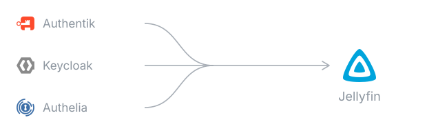
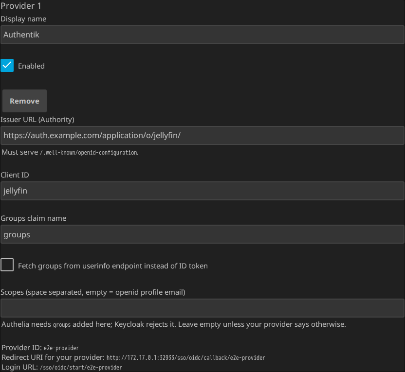

<div align="center">



# Jellyfin SSO Authentication

**Log in to Jellyfin with the account you already have — and let your identity provider's
groups decide who sees which libraries.**

[](https://github.com/be-nj/jellyfin-sso/actions/workflows/test.yml)
[](https://github.com/be-nj/jellyfin-sso/releases)
[](https://jellyfin.org)
[](LICENSE)

[Install](#install) · [Set it up](#set-it-up) · [Documentation](docs/README.md) ·
[Troubleshooting](docs/troubleshooting.md)

</div>

---

OpenID Connect single sign-on for Jellyfin — for households already running
[Authentik](docs/authentik.md), [Keycloak](docs/keycloak.md) or
[Authelia](docs/authelia.md).

- **Sign in through your provider.** PKCE public client, no secret stored.
- **Groups decide access** — libraries, Live TV, downloads, parental rating, admin —
  reapplied on every login.
- **Accounts created at first login**, existing ones [linked explicitly](docs/linking.md).
- **Phones and TVs** via Jellyfin's [Quick Connect](docs/clients.md).
- **Several providers at once**, each with its own login button — plain, or painted in
  the provider's colour.
- **Optional single logout** that ends the provider's session too.
- **Lockout guards** — the last administrator is never demoted.

## What it looks like

<div align="center">


</div>

Not a mock-up: the clip is a test run. A throwaway Jellyfin, a real Authentik in a
container, and the button this plugin adds — recorded by `make demo`, which fails if any
step of the login does not happen. [Sharper version](docs/img/login-flow.mp4).

## How it is tested

Against real software, not mocks. Every push runs:

| | |
|---|---|
| **182 unit tests** | Token validation, permissions, lockout guards, markup |
| **66 end-to-end tests** | Throwaway Jellyfin container, fake provider, real browser |
| **Three Jellyfin versions** | The same build against 12.0, 12.1 and 12.2 |
| **9 real-provider logins** | Authentik, Keycloak and Authelia, through their own forms |
| **Mutation testing** | Stryker checks that the tests notice a defect; floor in CI |
| **CodeQL** | No open alerts |

The provider guides are the configuration those containers get, and the screenshots come
from the running plugin. What the plugin trusts, and which test holds each claim:
[threat model](docs/threat-model.md).

## Compared with the other plugins

Most alternatives are forks of the archived
[9p4/jellyfin-plugin-sso](https://github.com/9p4/jellyfin-plugin-sso).
[K0lin's](https://github.com/K0lin/jellyfin-plugin-sso) is the most active, supports SAML
and lists more providers — worth a look if you need either.

This one is a separate implementation, not a fork: 30 of its 1,092 significant lines also
appear in 9p4's sources, all of them `using` directives, Jellyfin CSS classes and one-line
properties. Hence MIT where the forks are GPL-3.0.

Different routes it takes:

- **Identity is keyed by `(provider, sub)`, never by username**, so an account cannot be
  reached by registering the right name at the provider. Accounts that existed before SSO
  are [linked explicitly](docs/linking.md).
- **The last administrator is never demoted**, and individual users can be excluded from
  sync, so a mistyped group name is recoverable.
- **No client secret in the configuration file.** PKCE by default; a confidential client
  reads its secret from the environment or a file at login.
- **The supported Jellyfin range is measured** — every push runs the end-to-end suite
  against 12.0, 12.1 and 12.2.
- **Self-service linking, several providers at once, RP-initiated logout** and Quick
  Connect for TVs.
- **OIDC only.** SAML is out of scope here; if you need it, K0lin's fork has it.

## Install

Dashboard → **Plugins → Repositories → +**, name it `SSO Authentication`, URL:

```
https://raw.githubusercontent.com/be-nj/jellyfin-sso/main/manifest.json
```

Then **Plugins → Catalog → Authentication → SSO Authentication → Install**, and restart.

- Needs **Jellyfin 12.0 or newer** — an empty catalog means yours is older
  ([table](docs/requirements.md#jellyfin-version)).
- The same file is served from this repository itself, so you can read it before you
  trust it, and the release ZIP it points to carries
  [build provenance](https://github.com/be-nj/jellyfin-sso/attestations).
- Shorter to type, same file: `jf.be-nj.net/m.json`.
- Building it yourself: [CONTRIBUTING.md](CONTRIBUTING.md).

> ### Before you switch
>
> - **Existing accounts, history and favourites stay.**
> - **An SSO user can no longer sign in with a Jellyfin password.**
> - **Keep one local administrator** with a password — your way back in when the provider
>   is down.
> - **Permissions are rewritten from the groups on every login**, over anything you set by
>   hand ([unless the user is excluded](docs/configuration.md#safety)).
> - **Anyone your provider lets through gets an account.** Gate it there.
>
> Reversible: [uninstall path](docs/recovery.md#uninstalling).

## Set it up

Authentik as the example; [Keycloak](docs/keycloak.md) and [Authelia](docs/authelia.md)
differ in steps 4 and 5. Half an hour the first time.

1. **Back up Jellyfin's config, server stopped** —
   [two commands](docs/recovery.md#backup-and-restore). A copy taken while it runs is not
   a backup.
2. **Install the plugin** ([above](#install)) and restart.
3. **Add a provider**, display name only, **Save**. Dashboard → **Plugins → SSO
   Authentication → Providers → + Add Provider**. It starts disabled and prints the
   **Redirect URI** you need next.

   <a href="docs/img/provider-card.png"></a>

   Use **the address your household uses** when you open the dashboard — the redirect URI
   is built from it ([why](docs/requirements.md#one-address-for-jellyfin-used-everywhere)).
4. **Create the application at your provider**, public client, with that redirect URI:
   [Authentik](docs/authentik.md) (needs a *Signing Key*), [Keycloak](docs/keycloak.md),
   [Authelia](docs/authelia.md). Note the **Client ID** and the **issuer URL**.
5. **Finish the provider card**: issuer URL, client id, **Enabled**, **Save**. No restart
   ([every field](docs/configuration.md#providers)).
6. **Map a group**: **Group Mappings → + Add Mapping**, group name exactly as the provider
   spells it, tick libraries, **Save**. No mapping means people sign in and see nothing
   ([permissions](docs/configuration.md#group-mappings)).
7. **Test with a throwaway account**, not your own: `/sso/oidc/start` in a private window,
   signed in as a spare user from that group. Their Jellyfin account appears on the spot.
8. **Link your existing accounts.** The first SSO login for a name that already exists is
   refused until an administrator links it ([how](docs/linking.md#manual-linking)). Leave
   one administrator unlinked.

Errors: [Troubleshooting](docs/troubleshooting.md). Locked out:
[If something goes wrong](docs/recovery.md).

## Documentation

| | |
|---|---|
| [Requirements and versions](docs/requirements.md) | Which build fits which Jellyfin, addresses, reachability |
| [Authentik](docs/authentik.md) · [Keycloak](docs/keycloak.md) · [Authelia](docs/authelia.md) | The work on the provider's side |
| [Configuration reference](docs/configuration.md) | Every field on the plugin page |
| [Linking accounts](docs/linking.md) | The IdP subject, manual and self-service linking |
| [Login button and logout](docs/login-and-logout.md) | Branding button, signing out of the provider too |
| [Phones, tablets and TVs](docs/clients.md) | Quick Connect, and why there is no QR code yet |
| [Troubleshooting](docs/troubleshooting.md) · [If something goes wrong](docs/recovery.md) | Errors, lockout, backup and restore, uninstalling |
| [Security notes](docs/security.md) · [Glossary](docs/glossary.md) | What is validated and stored; the vocabulary in plain words |

## Contributing

- **Issues and patches:** <https://github.com/be-nj/jellyfin-sso/issues> — attach the
  Jellyfin log around the failed login, your provider and the plugin version.
- **Building, the test tiers, releases:** [CONTRIBUTING.md](CONTRIBUTING.md) ·
  **decisions:** [docs/adr/](docs/adr/) · **reviews:** [docs/reviews/](docs/reviews/)
- **Roadmap:** active revocation (today group changes apply at the next login); QR-code
  login and the device-code grant, both needing changes in the Jellyfin apps.

## License

[MIT](LICENSE).
