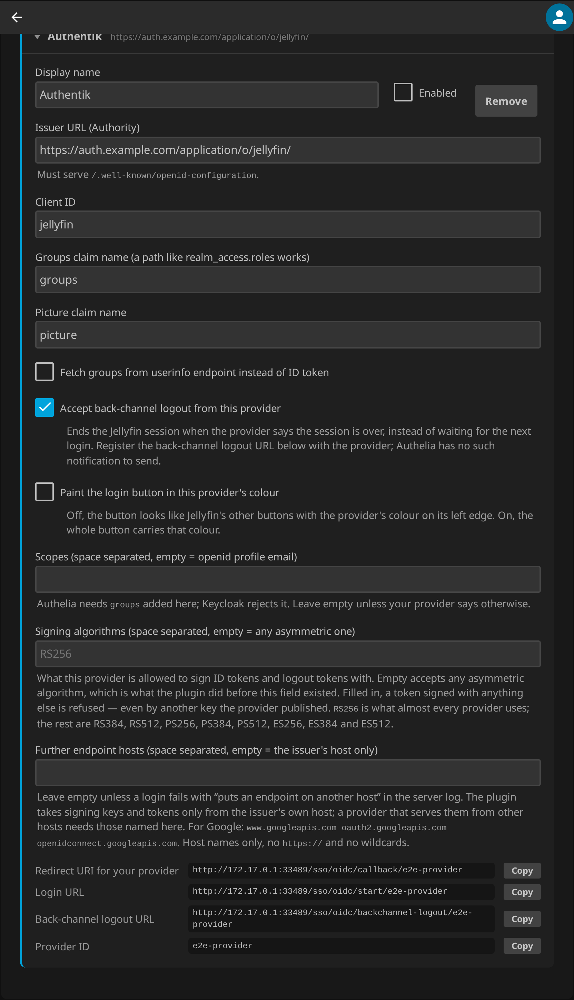
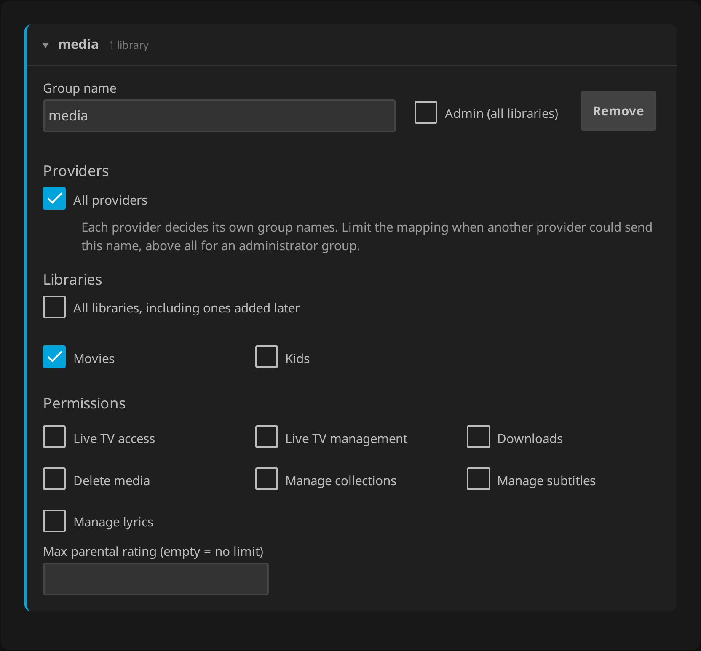

# Configuration reference

[Documentation index](README.md) · [README](../README.md)

Dashboard → **Plugins → SSO Authentication**.

## Providers

One card per identity provider: *Display name*, *Enabled*, *Issuer URL* (must answer at
`<issuer>/.well-known/openid-configuration`), *Client ID*, *Groups claim name*, *Fetch
groups from userinfo endpoint*, *Accept back-channel logout*, *Paint the login button in
this provider's colour*, *Scopes*. The card prints the provider id, the redirect URI, the
login URL and the back-channel logout URL.

*Picture claim name* (default `picture`) is only read while profile pictures are switched
on, below, and takes a path the same way the groups claim does.

*Groups claim name* takes a nested path as well. The name is looked for as it stands
first, so a claim really called `urn:zitadel:iam:org:project:roles` is still found; if no
claim goes by that name, the dots are read as a path. `realm_access.roles` is where
Keycloak keeps its roles when nothing has been mapped, and
`resource_access.<client>.roles` is where Entra ID keeps a client's. A mapper at the
provider that publishes a plain `groups` claim is still the tidier setup — the
[Keycloak guide](keycloak.md) sets one up — but the path means a working claim no longer
has to be moved before this plugin can see it.

<a href="img/provider-card.png"></a>

Leave *Scopes* empty to request `openid profile email`. [Authelia](authelia.md) needs
`groups` added; [Keycloak](keycloak.md) rejects it.

*Signing algorithms* is empty by default, which accepts any asymmetric algorithm the
provider's published keys support — what the plugin did before the field existed. Fill it
in with what your provider actually signs with, almost always `RS256`, and a token signed
with anything else is refused, even when the key that signed it is one the provider
published. Several names are separated by spaces; the accepted ones are `RS256`, `RS384`,
`RS512`, `PS256`, `PS384`, `PS512`, `ES256`, `ES384` and `ES512`, and anything else is
refused when you save rather than ignored later.

It is worth setting and it is not urgent. Every key in a provider's set belongs to the
provider, so this is not what keeps a forged token out — `aud`, `iss`, the signature and
the nonce are. What it removes is the provider's freedom to pick a weaker key out of its
own set after the fact, and it is what the
[conformance suite](reviews/2026-11-06-oidc-conformance.md) asks a client to do.

*Further endpoint hosts* is empty by default, and for a provider that runs on one host
name it stays empty. **Check saved settings**, below, says whether yours needs it. The plugin takes signing keys and tokens only from the host of the
issuer URL: the discovery document says where they are, and a document that could send the
plugin anywhere for the keys that decide whether a login is genuine would be deciding that
for itself. A few providers do serve them from other hosts. Google's issuer is
`accounts.google.com`, and it publishes its keys on `www.googleapis.com`, its token
endpoint on `oauth2.googleapis.com` and userinfo on `openidconnect.googleapis.com`; until
those are named, every login there is refused and the server log says so:

```
The discovery document for https://accounts.google.com puts an endpoint on another host:
jwks_uri on www.googleapis.com, token_endpoint on oauth2.googleapis.com, … name the hosts
under 'Further endpoint hosts' on the provider card: www.googleapis.com
oauth2.googleapis.com openidconnect.googleapis.com
```

The last line is what goes into the field: host names separated by spaces, with a port
where the endpoints use one, and nothing else — no `https://`, no path and no wildcard,
all of which are refused when you save. A host you name is trusted for this provider's
keys, token, userinfo and end-session endpoints as far as the issuer's own host is, so
name what the provider documents and not what a log line happens to ask for: check the
hosts against the provider's own documentation first.

> **Google, specifically.** Naming those three hosts is what a Google login needs from
> this field. A complete Google login was walked by hand once, on 16 November 2026, and
> the [Google guide](google.md) is written from it; Google is not in the test matrix CI
> runs, so it is checked less than the three providers that are. Two things follow from
> how Google works rather than from this plugin. Google decides who may sign in: an OAuth
> client with the audience *Internal* admits your Workspace organisation, one left in
> *Testing* admits the test users you listed, and a published *External* client admits
> **anyone with a Google account**, each of whom gets a Jellyfin account at their first
> login. And Google sends no groups, so no mapping ever matches: those accounts have no
> libraries. For such a provider, leave **Create an account at first login** off and turn
> **Set permissions from this provider's groups** off as well, both below.

*Create an account at first login* decides what happens to somebody the provider vouches
for and this server has never seen. On, they get a Jellyfin account on the spot — right
where the provider decides who may use Jellyfin at all, with an Authentik policy, a
Keycloak client scope or an Authelia access rule. Off, they are turned away and nothing is
written for them; only an identity that is already linked signs in, either
[by an administrator](linking.md#manual-linking) or by the person themselves from an
account they already have ([self-service linking](linking.md#self-service-linking)).

Off is for a provider that admits everybody it knows. With a published Google client, on
means every Google account holder can create an account on your server. It would have no
libraries, since Google sends no groups, and it would still be a signed-in account.

A provider you add starts with it **off**, so turn it on when you finish the card if your
provider is the kind that decides who gets in. A provider that existed before 1.12.21
keeps it on: nothing changes on upgrade.

It differs from *Refuse logins that match no mapping* [below](#safety) in two ways. That
one is for the whole server and this one is per provider; and that one asks about groups
at every login, also of accounts that exist, while this one only asks whether there is an
account.

*Set permissions from this provider's groups* is on by default, and it is the plugin's
normal working: every login sets the account's libraries, permissions and administrator
flag from the [group mappings](#group-mappings), and takes away what the groups no longer
grant. A provider that sends no groups breaks that — "no groups" is applied like any other
answer, so the first login leaves the account without a library. Off, a login through
this provider leaves the account exactly as you set it by hand: its libraries, its
administrator flag, and its own password login. That is what *Excluded from sync* does for
one account, done for everybody who signs in through this provider.

Two consequences. *Refuse logins that match no mapping* does not apply to such a provider,
since no login there could ever match; who gets in is decided by the links and by *Create
an account at first login*. And an account linked to two providers follows whichever it
last signed in through — the one that sets permissions sets them, the other leaves them.

**Check saved settings**, at the foot of the card, asks the server to look at the provider
the way a login is about to: it fetches the discovery document and the keys and lists
what it found — the issuer, the endpoints, how many keys, and for a confidential client
whether the secret is where its reference says. A refusal is shown in full, so a provider
whose endpoints are on hosts you have not named tells you which to name without anybody
attempting a login. It checks the settings as last **saved**, signs nobody in and stores
nothing; a provider you have not enabled yet can be checked first.

A new provider is created **disabled**, and one with nothing but a display name saves — so
you can hand its redirect URI to the provider before the rest exists.

With several providers enabled, `/sso/oidc/start` asks which one; with one it goes
straight there.

### Confidential clients

The client secret has no field on the page, so it never reaches the plugin's configuration
file. The plugin stores a reference and reads the value at login: `env:JELLYFIN_SSO_SECRET`
for an environment variable on the Jellyfin container, `file:/run/secrets/sso` for a file.
Set it through the admin API with an API key from Dashboard → **API Keys → +**:

```bash
curl -X POST "https://<your-jellyfin>/sso/admin/config" \
  -H 'Authorization: MediaBrowser Token="<admin token>"' \
  -H 'Content-Type: application/json' \
  -d @config.json
# config.json is what GET /sso/admin/config returns, with two fields changed in the
# provider's entry: "ClientType": 1 and "ConfidentialSecretRef": "env:JELLYFIN_SSO_SECRET".
```

A public client with PKCE is the default and covers most setups.

The secret is sent to the provider's token endpoint with HTTP Basic authentication
(`client_secret_basic`), which is what OpenID Connect expects unless a client registered
otherwise. If the provider's discovery document says it takes the secret as a form
parameter and not with Basic (`client_secret_post`), the plugin sends it that way
instead; there is nothing to set. A public client sends no credentials at all, only its
client id.

## Sessions

- **Put a login button on the login page** — on by default; writes the button into
  Jellyfin's branding, below the form.
- **Use the provider's own logo on the button** — on by default; the server fetches and
  caches the provider's logo ([Login and logout](login-and-logout.md)).
- **Put the button inside the login form** — off by default; adds a script tag to
  Jellyfin's page as it is served so the button sits with *Sign In*
  ([Login and logout](login-and-logout.md)).
- **Sign out of the identity provider too** — [Login and logout](login-and-logout.md).
- **Accept back-channel logout from this provider** (per provider, on by default) — lets
  the provider end a Jellyfin session when the session ends on its side
  ([Login and logout](login-and-logout.md#back-channel-logout)).
- **Let users link their own account** — [Linking accounts](linking.md).
- **Login requests per minute, per address** — 60 by default. The parts of a login that
  need no Jellyfin account — starting a login, the provider's callback, a Quick Connect
  approval, a back-channel logout — are counted per network address, and a caller past the
  count is answered `429 Too Many Requests` with a `Retry-After`. A login spends two of
  them, three with Quick Connect, so 60 is twenty logins a minute from one address.
  Everyone behind the same router is one address, and so is the provider's own back end
  when it sends back-channel logouts — raise it if a large household or a busy provider
  runs into it. Behind a reverse proxy, the address is whatever Jellyfin itself resolved
  it to: without the proxy listed under Dashboard → Networking → *Known proxies*, every
  request looks like it came from the proxy and the whole household shares one count.
  `0` turns the limit off, and saving this page clears the counts, so a limit you just
  raised applies to whoever is being turned away right now. Jellyfin's login page, the
  button and its mark are never counted: they have to keep working for everybody else
  while one caller is being refused.

### Profile pictures

*Take the profile picture from the provider* is off by default. Switched on, the picture
the provider publishes becomes the Jellyfin profile picture at every login, replacing one
somebody chose in Jellyfin — so turn it on only where the provider is where the household
keeps its photos. Users in the exclusion list keep their own picture either way.

The address comes out of the token, which means the server fetches whatever it points at —
and on several providers that attribute is one the user can edit, so the address is theirs
while the request is the server's. Only absolute `http`/`https` addresses are fetched,
three redirects at most **with every hop checked, not only the first**, 2 MB at most, and
only JPEG, PNG, GIF and WebP; anything else — an SVG, an HTML error page, a body that
keeps coming — is logged and ignored. A picture that does not arrive never fails a login.

Where it may be fetched *from* is limited too. The provider's own address is always
allowed, which is where avatars normally live, and so is any public address. An address
that only means something from inside — loopback, a private range, a link-local address, a
container name — is refused, because the bytes come back out again as that user's profile
picture and a request the server makes reaches whatever the server can reach.
**Allow profile pictures from this network** lifts that for a household that serves its
avatars from a second machine on the same network; it changes nothing else. The same picture is fetched again at the next login — the provider is the one who
knows whether it changed — but only written when its bytes differ, so the clients' image
tags stay put.

Once in a while Jellyfin removes a picture that was just written. Its activity update for
another device of the same person saves a copy of the account read a moment before the
write, and that copy has no picture. The next login puts the picture back. Jellyfin's own
avatar upload is exposed to the same thing, and no plugin can take the lock that would
prevent it, because Jellyfin reads that copy before taking the lock.

## Group Mappings

One card per group: *Group name*, *Libraries*, **Admin (all libraries)**, *Live TV
access*, *Live TV management*, *Downloads*, *Delete media*, *Manage collections*,
*Manage subtitles*, *Manage lyrics*, *Max parental rating* (empty = no limit).

*All libraries, including ones added later* grants every library without making the group
administrators, and without naming the libraries: a library created afterwards is included
too. A mapping written outside the page (`"AllLibraries": true`) needs no library ids.

These four became plugin-managed in 1.12.14: set by hand in Jellyfin for an SSO user,
they now follow the groups from the next login. The exclusion list under *Safety* is the
way to keep a particular account out of that.

*Delete media* is the one to leave off unless it is meant: a deletion from the Jellyfin
client removes the file, not a database row. A group that stops granting it also loses
any per-folder deletion rights that were set by hand, since a folder list left behind
would keep granting what the switch just took away.

Being an administrator does not grant *Delete media* — Jellyfin's own user screen owns
that, and an operator who left it off meant it. Everything else on the card an
administrator gets.

Playback, transcoding and remuxing are not on the card. Every SSO user may play media —
that is what the login is for — and *Remote access* is Jellyfin's own, left where the
administrator set it.

<a href="img/group-mapping.png"></a>

The group name must match the provider's spelling. The field autocompletes from groups
seen at a login, so the first one is typed blind; after a test login the log shows what
arrived:

```
SSO sync for user …: admin=False, libraries=1, groups=media
```

> Mappings are applied on **every login**, over anything set by hand in Jellyfin's user
> screen. Nothing happens between logins: an edit you make by hand takes effect at once,
> for sessions that are already open too, and survives until that person signs in through
> SSO again.

A user in several groups gets the union: every library of every matched group, each
permission any group grants, and the most permissive parental rating — a group without a
limit lifts the limit.

## Published server address

Jellyfin's **Dashboard → Networking → Published server URIs** is not this plugin's
setting, but it decides one thing here. The login button the plugin writes into the
branding is a link, and branding is plain HTML with no idea where the server is. Without
a published address the link is root-relative — correct for every client that loaded the
web client from the server, and useless in an app that ships its own copy and runs it
locally, as Samsung's does: the button appears and submits to the television.

With `all=https://your-jellyfin` set, the button carries that address and works in those
apps too. Use the address people actually open; it is the same value Jellyfin hands to
clients for everything else.

## Safety

Same tab as the group mappings:

- **Refuse logins that match no mapping** — off by default. With it off, somebody in no
  mapped group signs in and gets an account with no libraries; with it on, that login is
  turned away and no account is created. It applies to accounts that already exist: once
  the **last** mapped group is gone at the provider, so is the login. Losing one of
  several mapped groups changes what the account can see, as it always did, and nothing
  more. Excluded users (below) are exempt, and the server log says which group nearly
  matched when one did.
- **Never remove administrator rights on login** — administrators keep the flag even when
  no admin group matches. Library access still comes from the groups.

> **When the sync cannot read a policy** it applies nothing and says so in the log,
> rather than writing a fresh one. A fresh policy would reset every field this plugin
> does not own — including *disabled* — so a login could quietly re-enable an account an
> administrator had switched off. The cost is the other direction: nothing is taken away
> either, so a user who just lost their administrator group keeps it until a login that
> can read the policy. The first failure undoes a decision nobody can see; the second
> corrects itself.
- **Excluded from sync** — one checkbox per Jellyfin user. They can log in via SSO, but
  their permissions are never touched. Tick your local administrator.

> **Lockout guard:** the last remaining administrator is never demoted, whatever the
> groups say, so a mistyped admin group leaves a warning in the log rather than locking
> everyone out.
>
> *Refuse logins that match no mapping* is the one switch that can turn SSO away from
> everybody at once — a claim name that matches nothing, or an empty mapping list, refuses
> every login. It cannot lock you out of the server itself: Jellyfin's own password login
> is untouched, and the refusals name their reason in the log. Keep one local
> administrator with a password, which is worth doing whatever this switch is set to.

## Account Links

Its own tab: the links between an identity and a Jellyfin account, the sign-ins recently
refused for want of one, and the form to add a link. See [Linking accounts](linking.md).

## Settings from a file

For a server set up by configuration management (Ansible, NixOS, a compose file), the
settings can come from a JSON file instead of the page. Point `JELLYFIN_SSO_SETTINGS_FILE`
at it on the Jellyfin container:

```json
{
  "Providers": [
    { "Id": "authentik", "Name": "Authentik", "Enabled": true,
      "Authority": "https://auth.example.org/application/o/jellyfin/", "ClientId": "jellyfin",
      "ClientType": "Confidential", "ConfidentialSecretRef": "env:JELLYFIN_SSO_SECRET",
      "Scopes": ["openid", "profile", "email", "groups"] }
  ],
  "GroupMappings": [{ "Group": "jellyfin-admins", "IsAdministrator": true }],
  "RequireMappedGroup": true
}
```

The names are those of `GET /sso/admin/config`. The file is read when Jellyfin starts; every
setting it names wins over the page, where it is shown and cannot be changed, and every
setting it leaves out stays editable there. Each provider needs a fixed `Id`, because links
refer to it. A file with any mistake in it — invalid JSON, a name that is not a setting, a
value the page would refuse — is not applied at all: the page says why, and the server keeps
the configuration it had. Links and the remembered group names are the plugin's own and
cannot be set this way.
