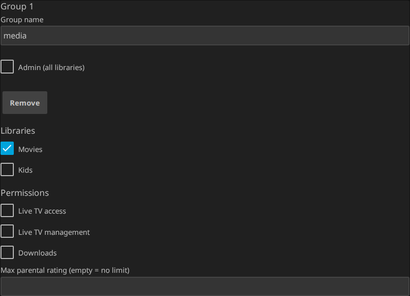

# Configuration reference

[Documentation index](README.md) · [README](../README.md)

Dashboard → **Plugins → SSO Authentication**.

## Providers

One card per identity provider: *Display name*, *Enabled*, *Issuer URL* (must answer at
`<issuer>/.well-known/openid-configuration`), *Client ID*, *Groups claim name*, *Fetch
groups from userinfo endpoint*, *Accept back-channel logout*, *Paint the login button in
this provider's colour*, *Scopes*. The card prints the provider id, the redirect URI, the
login URL and the back-channel logout URL.

<a href="img/provider-card.png"></a>

Leave *Scopes* empty to request `openid profile email`. [Authelia](authelia.md) needs
`groups` added; [Keycloak](keycloak.md) rejects it.

A new provider is created **disabled**, and one with nothing but a display name saves — so
you can hand its redirect URI to the provider before the rest exists.

With several providers enabled, `/sso/oidc/start` asks which one; with one it goes
straight there.

### Confidential clients

The client secret has no field on the page, so it never reaches the plugin's configuration
file. The plugin stores a reference and reads the value at login: `env:JELLYFIN_SSO_SECRET`
for an environment variable on the Jellyfin container, `file:/run/secrets/sso` for a file.
Set it through the admin API with an API key from Dashboard → **API Keys → +**:

```bash
curl -X POST "https://<your-jellyfin>/sso/admin/config" \
  -H 'Authorization: MediaBrowser Token="<admin token>"' \
  -H 'Content-Type: application/json' \
  -d @config.json
# config.json is what GET /sso/admin/config returns, with two fields changed in the
# provider's entry: "ClientType": 1 and "ConfidentialSecretRef": "env:JELLYFIN_SSO_SECRET".
```

A public client with PKCE is the default and covers most setups.

## Sessions

- **Put a login button on the login page** — on by default; writes the button into
  Jellyfin's branding, below the form.
- **Use the provider's own logo on the button** — on by default; the server fetches and
  caches the provider's logo ([Login and logout](login-and-logout.md)).
- **Put the button inside the login form** — off by default; adds a script tag to
  Jellyfin's page as it is served so the button sits with *Sign In*
  ([Login and logout](login-and-logout.md)).
- **Sign out of the identity provider too** — [Login and logout](login-and-logout.md).
- **Accept back-channel logout from this provider** (per provider, on by default) — lets
  the provider end a Jellyfin session when the session ends on its side
  ([Login and logout](login-and-logout.md#back-channel-logout)).
- **Let users link their own account** — [Linking accounts](linking.md).
- **Login requests per minute, per address** — 60 by default. The parts of a login that
  need no Jellyfin account — starting a login, the provider's callback, a Quick Connect
  approval, a back-channel logout — are counted per network address, and a caller past the
  count is answered `429 Too Many Requests` with a `Retry-After`. A login spends two of
  them, three with Quick Connect, so 60 is twenty logins a minute from one address.
  Everyone behind the same router is one address, and so is the provider's own back end
  when it sends back-channel logouts — raise it if a large household or a busy provider
  runs into it. Behind a reverse proxy, the address is whatever Jellyfin itself resolved
  it to: without the proxy listed under Dashboard → Networking → *Known proxies*, every
  request looks like it came from the proxy and the whole household shares one count.
  `0` turns the limit off, and saving this page clears the counts, so a limit you just
  raised applies to whoever is being turned away right now. Jellyfin's login page, the
  button and its mark are never counted: they have to keep working for everybody else
  while one caller is being refused.

## Group Mappings

One card per group: *Group name*, *Libraries*, **Admin (all libraries)**, *Live TV
access*, *Live TV management*, *Downloads*, *Max parental rating* (empty = no limit).

<a href="img/group-mapping.png"></a>

The group name must match the provider's spelling. The field autocompletes from groups
seen at a login, so the first one is typed blind; after a test login the log shows what
arrived:

```
SSO sync for user …: admin=False, libraries=1, groups=media
```

> Mappings are applied on **every login**, over anything set by hand in Jellyfin's user
> screen. Nothing happens between logins: an edit you make by hand takes effect at once,
> for sessions that are already open too, and survives until that person signs in through
> SSO again.

A user in several groups gets the union: every library of every matched group, each
permission any group grants, and the most permissive parental rating — a group without a
limit lifts the limit.

## Safety

Same tab as the group mappings:

- **Never remove administrator rights on login** — administrators keep the flag even when
  no admin group matches. Library access still comes from the groups.
- **Excluded from sync** — one checkbox per Jellyfin user. They can log in via SSO, but
  their permissions are never touched. Tick your local administrator.

> **Lockout guard:** the last remaining administrator is never demoted, whatever the
> groups say, so a mistyped admin group leaves a warning in the log rather than locking
> everyone out.

## Account Links

Its own tab: the links between an identity and a Jellyfin account, and the form to add
one. See [Linking accounts](linking.md).
