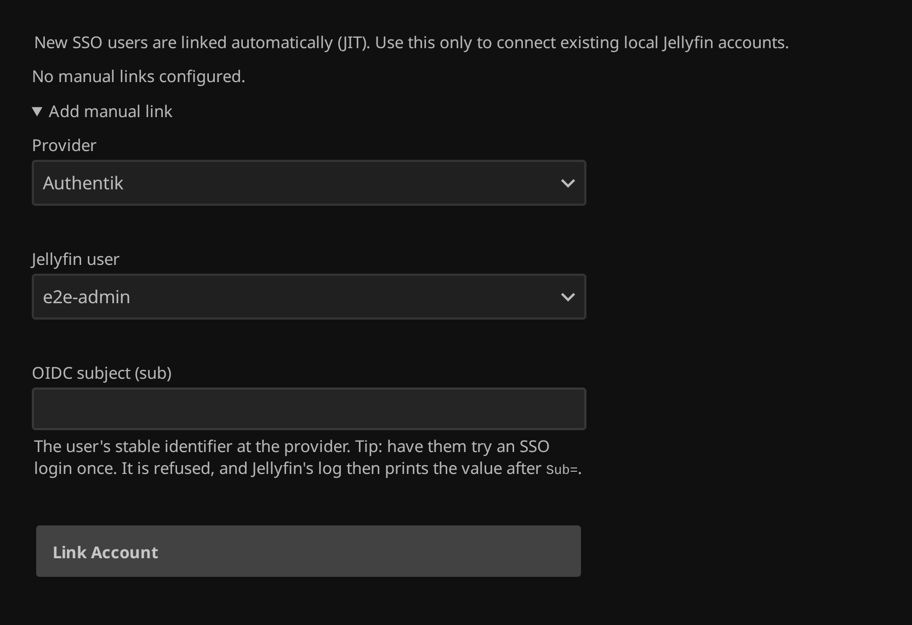

# Linking accounts

[Documentation index](README.md) · [README](../README.md)

New users are linked at their first SSO login. Linking by hand is for accounts that
existed before SSO.

## Identity matching and the IdP subject

The plugin keys each Jellyfin user to an identity by `(provider, sub)`, **never by
username** — that is what made the old plugin's admin takeover possible. An unknown `sub`
becomes a new account, so the first SSO login for an existing username is refused with
*"Username 'ben' already exists"* until an administrator links it.

### Authentik: Subject mode

**Applications → Providers → (your provider) → Advanced protocol settings → Subject mode**
decides what `sub` contains:

| Subject mode | `sub` value | |
|---|---|---|
| **Hashed ID (default)** | opaque SHA256 hash | **Recommended.** Survives renames; learnable only from a login. |
| Username | the username | Easy to link by hand; changes when the person is renamed. |
| UUID | the user UUID | Stable; readable via `/api/v3/core/users/`. |

In username mode a rename at the provider breaks that person's link, and a username that
is later given to someone else would reach the old account. It is a good fit when
usernames in your directory are never reused, and worth avoiding otherwise.

## Manual linking

**Account Links** tab:

<a href="img/account-links.png"></a>

*Provider* and *Jellyfin user* are dropdowns. *Subject* is the `sub` at the provider —
with Authentik's username mode, the username.

Otherwise you cannot know it in advance: let the person log in once. The attempt is
refused, and the log (Dashboard → **Logs**, or `docker logs jellyfin`) carries the value:

```
[WRN] Jellyfin.Plugin.Sso.Provisioning.UserProvisioner: SSO JIT blocked: username 'ben'
already exists. ProviderId=ab12… Sub=f81d4fae-7dec-11d0-a765-… JellyfinUserId=…
```

Copy the `Sub=` value into the form, one person at a time. Keep one administrator
unlinked, with a password.

## Self-service linking

With **Let users link their own account** enabled, a signed-in user links themselves at
**`/sso/link`**: the page uses the session the web client stored, runs the OIDC flow and
attaches the identity. An identity already linked to a different Jellyfin account is
refused; only an administrator can move a link.

Users cannot unlink from the web client. An administrator removes links on the **Account
Links** tab; `DELETE /sso/link/self` with the user's own token exists, but nothing calls
it.

Linking grants nothing. Libraries and the admin flag come from the groups at the next
login.
