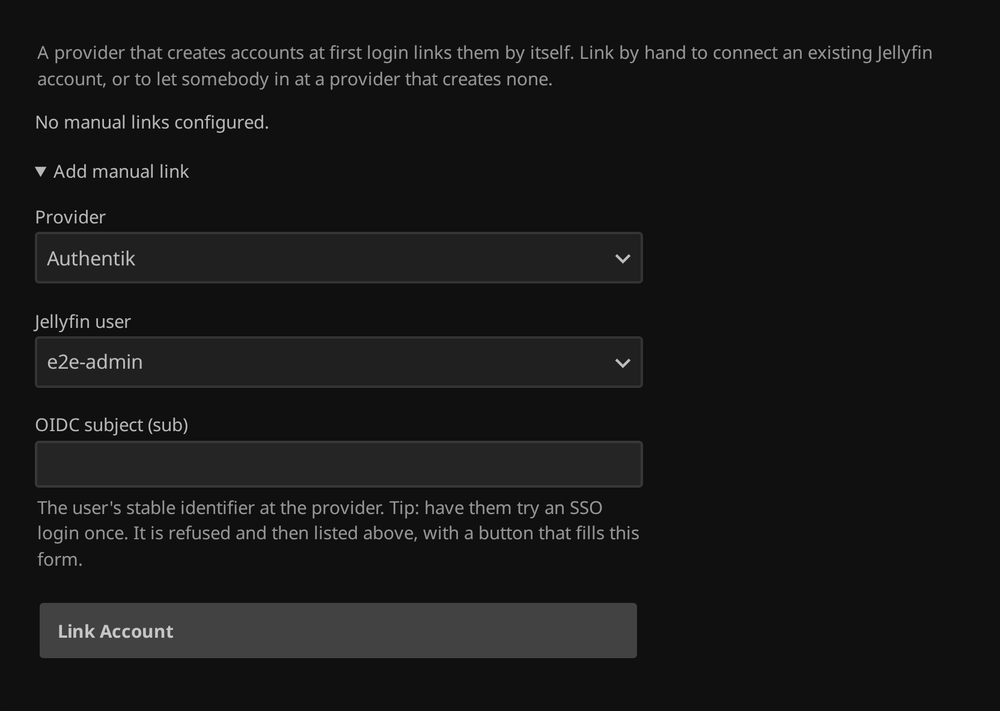

# Linking accounts

[Documentation index](README.md) · [README](../README.md)

New users are linked at their first SSO login. Linking by hand is for accounts that
existed before SSO.

## Identity matching and the IdP subject

The plugin keys each Jellyfin user to an identity by `(provider, sub)`, **never by
username** — that is what made the old plugin's admin takeover possible. An unknown `sub`
becomes a new account, so the first SSO login for an existing username is refused with
*"Username 'ben' already exists"* until an administrator links it.

### Authentik: Subject mode

**Applications → Providers → (your provider) → Advanced protocol settings → Subject mode**
decides what `sub` contains:

| Subject mode | `sub` value | |
|---|---|---|
| **Hashed ID (default)** | opaque SHA256 hash | **Recommended.** Survives renames; learnable only from a login. |
| Username | the username | Easy to link by hand; changes when the person is renamed. |
| UUID | the user UUID | Stable; readable via `/api/v3/core/users/`. |

In username mode a rename at the provider breaks that person's link, and a username that
is later given to someone else would reach the old account. It is a good fit when
usernames in your directory are never reused, and worth avoiding otherwise.

### Tinyauth: the subject moves with the username

Tinyauth derives `sub` from the client id and the username, so it behaves like Authentik's
username mode without the choice: rename somebody and their link breaks, recreate the OIDC
client and every link breaks at once. [Tinyauth](tinyauth.md) has the rest.

## Manual linking

**Account Links** tab:

<a href="img/account-links.png"></a>

*Provider* and *Jellyfin user* are dropdowns. *Subject* is the `sub` at the provider —
with Authentik's username mode, the username.

Otherwise you cannot know it in advance: let the person log in once. The attempt is
refused, and the tab then lists it under **Refused sign-ins** — when, at which provider,
the name the provider sent, the subject, and why. **Link…** fills the provider and the
subject into the form; the Jellyfin user is yours to choose.

It is yours to choose on purpose. The name in that list is whatever the provider sent, and
at a provider where people pick their own display name — Google is one — anybody can be
called *admin*. The plugin never matches an identity to an account by name, and the page
does not suggest one either. Link somebody you know to the account you know is theirs.

The list is a convenience kept in the server's memory: the fifty most recent refusals, a
day at most, gone at a restart, and **Clear list** empties it. A linked identity drops off
it. The server log carries the same value, for when the list no longer does:

```
[WRN] Jellyfin.Plugin.Sso.Provisioning.UserProvisioner: SSO JIT blocked: username 'ben'
already exists. ProviderId=ab12… Sub=f81d4fae-7dec-11d0-a765-… JellyfinUserId=…
```

and, at a provider with *Create an account at first login* off:

```
[WRN] Jellyfin.Plugin.Sso.Provisioning.UserProvisioner: SSO login refused: no account is
linked to this identity and the provider does not create accounts at first login. To link
it: ProviderId=ab12… Sub=f81d4fae-7dec-11d0-a765-…
```

One person at a time. Keep one administrator unlinked, with a password.

## Self-service linking

With **Let users link their own account** enabled, a signed-in user links themselves at
**`/sso/link`**: the page uses the session the web client stored, runs the OIDC flow and
attaches the identity. An identity already linked to a different Jellyfin account is
refused; only an administrator can move a link.

Users cannot unlink from the web client. An administrator removes links on the **Account
Links** tab, and a user can remove their own with
`DELETE /sso/link/self?providerId=…` and their own token — nothing in the interface calls
it, but it is live, so it is worth knowing what it does.

Unlinking yourself ends your Jellyfin sessions. The link is how a logout announced by the
provider finds the account, so an account without one holds tokens the provider can no
longer end, and Jellyfin's tokens do not expire on their own. The provider has to be
named: without one, this used to remove every link the caller had.

Linking grants nothing. Libraries and the admin flag come from the groups at the next
login.
