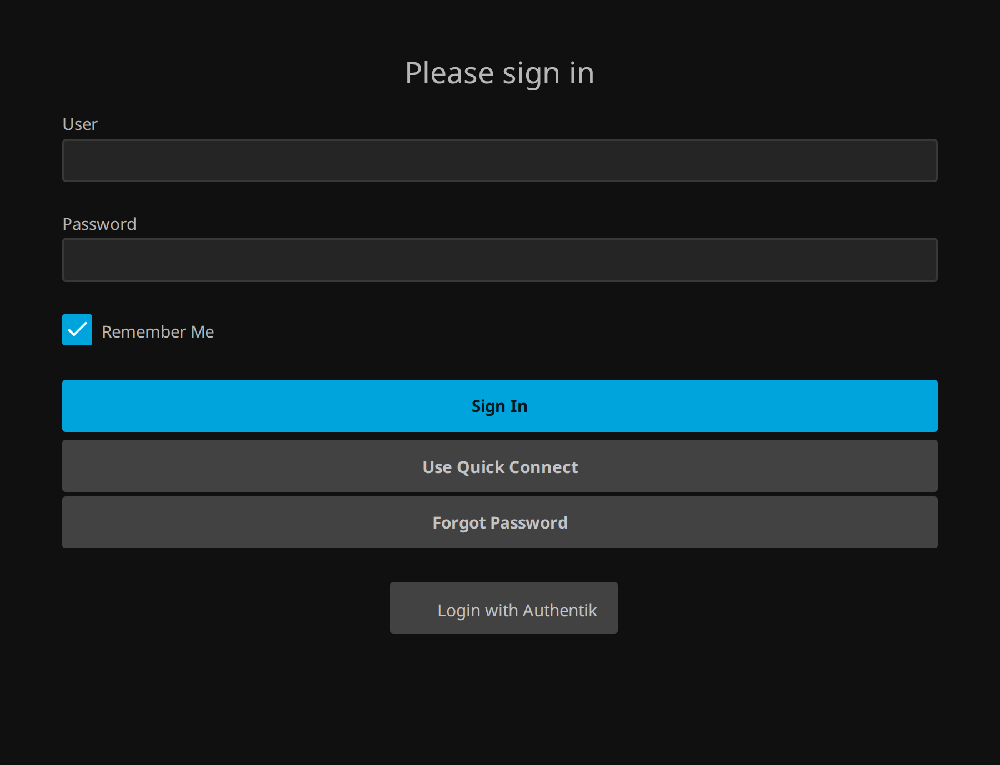
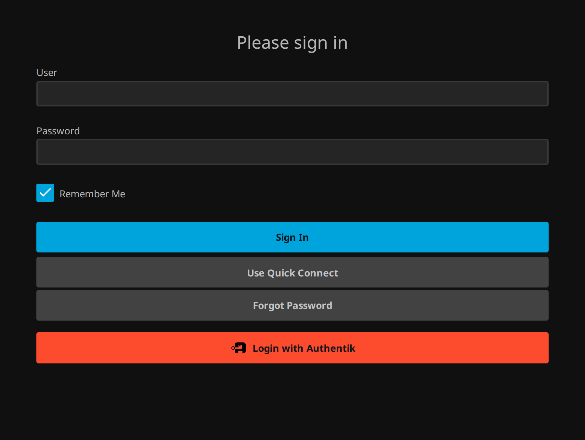

# Login button and logout

[Documentation index](README.md) · [README](../README.md)

## Login button

**Built in:** saving the configuration writes one button per enabled provider into
Jellyfin's *Login Disclaimer*, unless *Put a login button on the login page* is turned off
on the **Sessions** tab — turn it off if you place your own button and do not want a
second one. The buttons sit between `<!-- sso-login-buttons:start -->`
and `:end`; only that part is ever rewritten, so your own text stays, and disabling every
provider removes the block alone.

<a href="img/login-button.png"></a>

**Two looks, per provider.** *Paint the login button in this provider's colour* on the
provider's card decides which one. Off, the button is one of Jellyfin's — the provider's
colour sits on its left edge alone. On, the whole button carries that colour, and the mark
and the label turn black or white, whichever reads on it. With several providers each one
chooses for itself.

<a href="img/login-button.png"></a>
<a href="img/login-button-branded.png"></a>

The colour is the provider's own, recognised from its name or its issuer — Authentik's
orange, Keycloak's grey, Authelia's and Google's blue, Okta's, Auth0's. A provider you
renamed is recognised by the path it issues from, because only authentik serves
`/application/o/` and only Keycloak serves `/realms/`. *Button colour* on the provider's
card overrides all of it; `#rgb` or `#rrggbb`, and anything else is ignored, because the
value is written into Jellyfin's custom CSS.

Black or white on top is picked by measuring the colour's luminance, not by taste, so a
light brand does not end up with white text nobody can read. The plugin's own marks are
flat shapes and are recoloured to match. A logo fetched from your provider is not: it can
be any shape and colour, and flattening it to one colour turns a rounded logo into a black
rectangle — so it keeps its colours and gets a light chip to sit on.

The whole login, recorded against a real Authentik in the test suite:

<a href="img/login-flow.mp4"></a>

The button is a small form in Jellyfin's own button classes, so themes style it like the
others. A form rather than a link because jellyfin-web rewrites every link in the
disclaimer to open in a new tab and routes the rest through its own router, which does not
know the plugin's addresses — see [issue 30](https://github.com/be-nj/jellyfin-sso/issues/30).
Under a sub-path the action picks up Jellyfin's *Base URL*, so
`/jellyfin/sso/oidc/start/<providerId>` works.

**Inside the login form (built in):** switch on *Put the button inside the login form* on
the **Sessions** tab. The plugin then adds one `<script>` tag to Jellyfin's page as it is
served — nothing is written to disk, nothing in the web folder changes, and turning the
switch off removes it again. The button lands next to *Sign In*, with the provider's mark
on it.

Turn the branding button off at the same time unless you want one in both places.

**JavaScript Injector**, if you already run that community plugin and prefer to keep your
own snippet, works too:

```js
// Puts an SSO button under Jellyfin's login form.
document.addEventListener('DOMContentLoaded', function () {
  const form = document.querySelector('.loginForm, form.login');
  if (!form || document.getElementById('ssoButton')) return;
  const button = document.createElement('a');
  button.id = 'ssoButton';
  button.className = 'raised block emby-button';
  button.href = '/sso/oidc/start';   // asks which provider, if there are several
  button.textContent = 'Sign in with SSO';
  form.appendChild(button);
});
```

**The mark on the button** comes from the provider itself where possible: with *Use the
provider's own logo on the button* on (the default), the server fetches the image your
provider shows on its own login page, caches it for twelve hours and serves it from
`/sso/icon/provider/<providerId>`. A household that rebranded its Authentik sees its own
mark in Jellyfin. The fetch happens on the server, so nobody's browser contacts the
provider before they choose to sign in, and anything that is not a small image is ignored.

Authentik publishes two brand images, and the favicon is taken before the logo: the logo
is the wide lockup from the top of its login page — the stock one is an icon with the
wordmark beside it — and a wide image in a mark-sized box is a smudge rather than a mark.
A provider that offers only a wide image still gets it: the mark is 22 pixels tall and as
wide as the picture needs, up to a limit, rather than squeezed into a square.

Without a reachable logo, or with the setting off, the plugin's own marks are served:
`/sso/icon/authentik`, `/sso/icon/keycloak`, `/sso/icon/authelia`, `/sso/icon/google`,
`/sso/icon/okta`, `/sso/icon/auth0`, and `/sso/icon/generic` for anything else.

## Logout

Jellyfin's logout drops its own token and leaves the provider session alone, so the next
login goes through without credentials. With **Sign out of the identity provider too**
enabled, sending the browser to **`/sso/oidc/logout`** after Jellyfin's logout requests
provider logout and returns to the web client. For a browser SSO login, the plugin sends
the validated ID token as `id_token_hint`, allowing providers such as Authentik to identify
the session rather than ask for confirmation.

The ID token stays in server memory, addressed by an opaque HttpOnly browser session
cookie, and **only while this setting is on** — a server that never signs anybody out of
their provider keeps nothing. It is replaced on the next browser SSO login and dropped
when this logout endpoint is visited, including a logout that does not use it; retention
is capped at 30 days and 10,000 browser logins. The hint becomes unavailable on server
restart or when the browser discards the cookie, and the next login brings it back.
Quick Connect and account linking do not replace the browser's logout context.
Back-channel logout revokes Jellyfin tokens but does not purge this browser cache; its
entries remain subject to the same retention limits.

With several providers, `/sso/oidc/logout` uses the provider from that browser's SSO login,
or the first enabled one if no retained login is available;
`/sso/oidc/logout/<providerId>` names it explicitly. A token is never sent to a different
provider or a changed authority/client ID.

Without a retained login (including sessions created before this update), the request
contains only `client_id` and `post_logout_redirect_uri`. Providers that accept this bare
request end their session; others, including Authentik, may require the user to confirm.
Returning to Jellyfin alone does not prove the provider session ended. Register the
post-logout redirect URI at your provider if it requires it.

**The switch alone changes nothing visible** — it only decides what `/sso/oidc/logout`
does. A server plugin cannot touch Jellyfin's logout button, so wiring the two together
needs the **JavaScript Injector** plugin:

```js
// Sends the browser on to the provider's logout once Jellyfin has signed the user out.
document.addEventListener('click', function (event) {
  if (event.target.closest('[data-action="logout"], .btnLogout')) {
    setTimeout(function () { window.location.href = '/sso/oidc/logout'; }, 500);
  }
});
```

If the provider advertises no `end_session_endpoint`, or cannot be reached, the user still
lands back in Jellyfin — a broken provider must never block a logout.

## Back-channel logout

The logout above is the one the user starts. The other direction — the provider telling
Jellyfin a session is over — is **back-channel logout**
([OpenID Connect Back-Channel Logout 1.0](https://openid.net/specs/openid-connect-backchannel-1_0.html)).
It is what ends a session when somebody is removed or signed out at the provider instead
of in Jellyfin. Without it, the Jellyfin session runs until its token is next refused,
which is to say until the next login.

Each provider card shows the URL to register:

```
https://jellyfin.example.com/sso/oidc/backchannel-logout/<providerId>
```

Register it with the provider and leave **Accept back-channel logout from this provider**
on. The provider then posts a signed `logout_token` there when the session ends, and the
plugin revokes every Jellyfin token of the account linked to that subject — the devices
are signed out, the account itself is untouched.

| Provider | Where |
|---|---|
| Authentik | the application's provider → *Advanced protocol settings* → **Backchannel logout URL** |
| Keycloak | the client → *Settings* → *Logout settings* → **Backchannel logout URL** |
| Authelia | not supported; logout stays what the section above describes |

The endpoint is anonymous, because the caller is the provider's back end and holds no
Jellyfin token. The logout token is therefore the whole of the authorisation, and it is
checked the way an ID token is — signature against the provider's JWKS, issuer, audience —
plus the rules the specification adds for this token in particular:

- the `events` claim has to name the back-channel logout event,
- a `nonce` must be absent, so an ID token cannot be replayed as a logout token,
- `iat` has to be there and no more than five minutes old, so a token captured once cannot
  end a session again tomorrow,
- `sub`, `sid` or both have to be there.

Anything else is a `400` and a line in the log. A token that names only `sid` is accepted
and does nothing: the plugin stores subjects, not provider sessions. A valid logout for a
subject nobody linked here is also a `200` — a provider announces a logout to every
application the person used, including those that never saw them.
